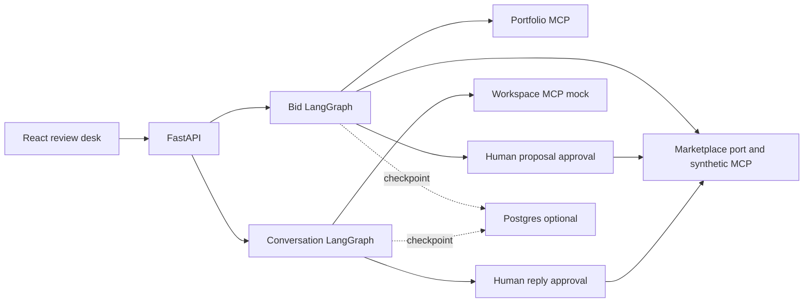

# GigBid


GigBid is an **in-progress** AI-4016 Assignment II project. The instructor supplied an example scaffold on 12 November 2026, but it contains no working GigSim service, personas, or evaluation data. The current web workflow uses clearly labeled synthetic jobs and a deterministic draft. A separate, attributed 2024 Kaggle dataset supplies descriptive budget aggregates, not client outcomes or evaluation labels. This is **not** a completed GigSim submission or measured marketplace result.

[](https://github.com/FazalZamanKhan/gigbid/actions/workflows/ci.yml)

## Architecture



## Development measurements

These are **four easy synthetic queries over six hand-written chunks**, not the assignment's official retrieval results. All six variants tied in the latest warm-cache run, so no production retriever has been selected. The corpus has no outcome scores, so V4 does not test outcome-aware ranking here.

| Retrieval path | Recall@5 | p95 query latency |
| --- | ---: | ---: |
| V0 dense | 1.00 | 16 ms |
| V1 decomposition | 1.00 | 47 ms |
| V2 BM25 + dense fusion | 1.00 | 29 ms |
| V3 cross encoder | 1.00 | 296 ms |
| V4 outcome-aware rerank (no outcome values in fixture) | 1.00 | 336 ms |
| V8 corrective graph | 1.00 | 54 ms |

The [raw six-variant synthetic result and provenance](evals/results/synthetic_retrieval_full.json) record the exact four cases. Earlier cold/warm runs differed in latency; these timings are local development observations, not a deployment target. The required single-agent and supervisor baselines have not been run; their comparison remains open until the prescribed data and simulator are available.

| Decision workflow | Synthetic approval path | Official decision and outcome comparison |
| --- | --- | --- |
| Current LangGraph branches | Bid approval, scam skip, injection skip checked | Pending GigSim data |
| Single-agent baseline | Not implemented | Pending |
| Supervisor baseline | Not implemented | Pending |

Four [public synthetic development traces](docs/traces/) show an [approved proposal](docs/traces/proposal-approved.json), [scam skip](docs/traces/scam-skipped.json), [injected instruction skip](docs/traces/injection-skipped.json), and [approved interview reply](docs/traces/interview-reply-approved.json). They are exported LangGraph state snapshots from MCP-backed runs, not production spans with tokens and cost.

## Current development slice

- A typed marketplace port has local direct and MCP-backed synthetic adapters. The example starter ZIP has no GigSim contract or service to integrate; a future adapter requires the actual simulator API.
- The bid graph analyses a job, retrieves synthetic portfolio evidence through an MCP session, checks the cited draft, runs a bounded rule-based Critic revision loop, and pauses for human approval before any marketplace write.
- A second LangGraph workflow classifies synthetic client replies, asks the Workspace MCP mock for interview slots, and pauses for approval before recording a synthetic message.
- A FastAPI API exposes jobs, bid and conversation runs, approvals, and health. The React UI displays the inbox, proposal review, message review, and a browser-local synthetic reviewer setup. It restores the last runs after a page reload when their checkpoints are available.
- Portfolio MCP provides read-only evidence tools and resource templates. A separate development Marketplace MCP server exposes synthetic job reads, a guarded draft tool, and a guarded message tool. The Workspace MCP server provides a local mock calendar and email draft store.
- A separate [retrieval experiment harness](docs/RAG_EVAL.md) runs V0, V1, V2, V3, V4 and a V8 LangGraph corrective path on caller-supplied labeled data. All six variants were run with open embedding and reranking models on a four-query synthetic smoke fixture; it cannot select a production variant.
- An [attributed data card](docs/DATA_CARD.md) and reproducible script derive fixed-price budget aggregates from the instructor-permitted 2024 Kaggle job postings dataset. No raw historical job text is committed or presented as current marketplace work.
- Seven Playwright end-to-end tests cover demo setup, approval, rejection, edited-draft hold, outage messaging, scam/injection skip, and client reply approval.

## Run locally

```bash
python3 -m venv .venv
. .venv/bin/activate
pip install -e '.[dev]'
make demo
```

For the web UI, run `cd apps/web && npm install && npm run dev`. The API is at `http://localhost:8000`; the Vite UI is at `http://localhost:5173`.

The partial containerized development stack runs with `docker compose -f infra/docker-compose.yml up --build` and serves the UI at `http://localhost:8080`. It uses Postgres for checkpoints and launches local MCP servers through stdio, but does not yet include the required GigSim, worker, or model service.

An optional single-origin hosting entry point is `apps.api.public:app`; `render.yaml` describes a free synthetic preview with Postgres checkpoints. Render's free Postgres expires after 30 days, so the preview needs maintenance or migration if grades remain pending. No public application has been deployed yet.

## Assignment status

See [docs/SUBMISSION_STATUS.md](docs/SUBMISSION_STATUS.md) for the rubric audit. The [public source repository](https://github.com/FazalZamanKhan/gigbid) contains the demo and evidence-limited report. The public application URL and official GigSim evaluation numbers remain pending. Reviewer credentials must be supplied in a private Google Classroom comment, never in the public repository.

The [published technical write-up](https://fazalzamankhan.github.io/gigbid/TECHNICAL_WRITEUP.html) describes the current prototype and its limitations. The synthetic [Portfolio MCP development release](https://github.com/FazalZamanKhan/gigbid/tree/portfolio-v0.1.0/mcp_servers/portfolio) has a documented `uvx` command and was installed from its public tag for an independent MCP protocol call.
The [three-minute captioned demo](https://fazalzamankhan.github.io/gigbid/DEMO.html) records the synthetic approval workflow, including the Critic revision, a client reply, and scam/injection skips. It has no audio or real marketplace action.
The [R&D PDF](output/pdf/GigBid_RD_Report.pdf) records verified engineering checks, attributed historical budget analysis, and explicit missing simulator results. It should be updated if the official GigSim assets or further measurements arrive before submission.
