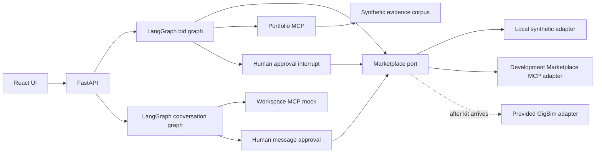

# Architecture (development state)

The marketplace port is the sole write boundary. The graph analyses a job through parallel Analyst, Risk Assessor, and Fit Matcher branches, then prepares a draft and pauses for approval. Local runs default to an in-memory checkpointer; the Docker development stack selects Postgres checkpoints. The local adapter and evidence corpus are synthetic, so they cannot support assignment results.

The fit node consumes the Portfolio MCP `search_evidence` tool over a stdio session. The Docker stack selects an MCP-backed implementation of the typed marketplace port; local tests can use the direct adapter. The conversation graph classifies synthetic incoming messages, reads mock free slots from the Workspace MCP server, drafts a reply, and requires a separate human approval interrupt before the Marketplace MCP message tool records it. The Workspace mock can also save idempotent tentative holds and email drafts; neither action contacts an external service. The real GigSim adapter, scheduled worker, tracing, and measured RAG variants remain to be implemented. Postgres checkpoints are available in the partial Docker development stack; other state is process-local or in a local mock SQLite store.
