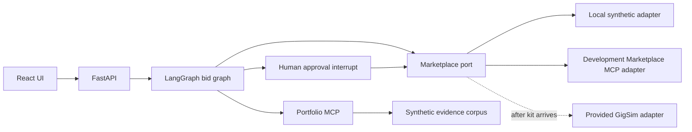

# Architecture (development state)

The marketplace port is the sole write boundary. The graph analyses a job through parallel Analyst, Risk Assessor, and Fit Matcher branches, then prepares a draft and pauses for approval. Local runs default to an in-memory checkpointer; the Docker development stack selects Postgres checkpoints. The local adapter and evidence corpus are synthetic, so they cannot support assignment results.

The fit node consumes the Portfolio MCP `search_evidence` tool over a stdio session. The Docker stack selects an MCP-backed implementation of the typed marketplace port; local tests can use the direct adapter. The required Workspace MCP server and real GigSim adapter remain absent, so the project does not yet meet the complete MCP-only access requirement. The full conversation graph, scheduled worker, tracing, and measured RAG variants remain to be implemented. Postgres checkpoints are available in the partial Docker development stack; other state is process-local.
