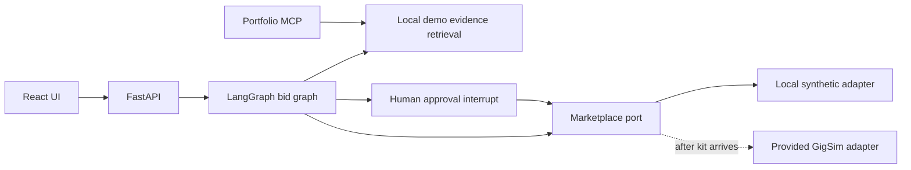

# Architecture (development state)

The marketplace port is the sole write boundary. The graph analyses a job through parallel Analyst, Risk Assessor, and Fit Matcher branches, then prepares a draft and pauses for approval. The current checkpointer is in-memory and must be replaced with Postgres before deployment. The local adapter and evidence corpus are synthetic, so they cannot support assignment results.

The graph currently calls the local retriever directly. It does not yet consume the Portfolio MCP server, so it does not meet the MCP-only agent access requirement. The full conversation graph, persistent memory, production MCP servers, scheduled worker, tracing, and measured RAG variants remain to be implemented after the starter kit arrives.
